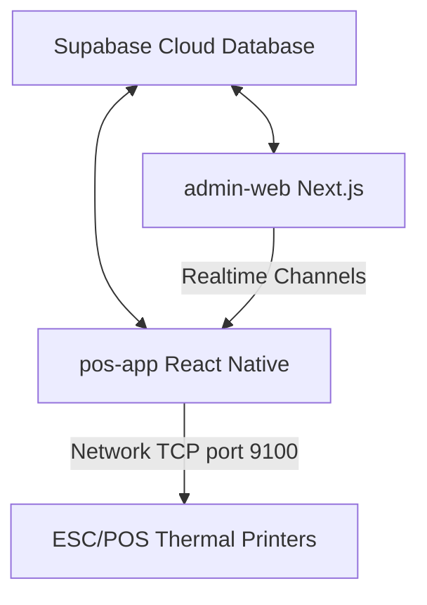

# Restaurant OS — Developer Handover & Technical Documentation

This document serves as the comprehensive technical handover guide for **Restaurant OS**. It details the system architecture, database schema, data sync layers, business rules, and code implementation details across all subprojects. If you are taking over this project, this guide will walk you through the codebase to help you get up to speed quickly.

---

## Table of Contents
1. [System Architecture Overview](#1-system-architecture-overview)
2. [Database Design & Schema (Supabase)](#2-database-design--schema-supabase)
3. [Admin Web Dashboard (Next.js)](#3-admin-web-dashboard-nextjs)
4. [POS Mobile Application (React Native Expo)](#4-pos-mobile-application-react-native-expo)
5. [State Management & Data Synchronization](#5-state-management--data-synchronization)
6. [Core Business Logic & Algorithms](#6-core-business-logic--algorithms)
7. [Printing Engine Implementation](#7-printing-engine-implementation)
8. [Setup & Developer Guide](#8-setup--developer-guide)

---

## 1. System Architecture Overview

Restaurant OS is an integrated, real-time Point of Sale (POS) and administration suite designed for restaurant environments. The repository is organized as a monorepo containing three core blocks:



- **`supabase/`**: Contains database schema migrations defining payments, inventory structures, and receipt configurations.
- **`admin-web/`**: A web application built with **Next.js 16 (App Router)** and **TailwindCSS 4** for restaurant managers. It manages floor plans, menus, users, settings, promotions, and displays analytical reports. It also implements the **Kitchen Display System (KDS)**.
- **`pos-app/`**: A mobile-first tablet application built with **React Native (Expo)**, **NativeWind (Tailwind CSS)**, and **Zustand** for waitstaff and cashiers to manage tables, place orders, process checkouts, and print receipts.

---

## 2. Database Design & Schema (Supabase)

The database runs on Supabase (PostgreSQL) with Row-Level Security (RLS) enabled. To simplify POS and admin integration, operations bypass strict user checks by using open RLS policy rules (`Allow all access` / `FOR ALL USING (true)`).

### Core Tables

#### 1. `usuarios` (Staff Users)
Stores credentials and permissions for restaurant staff. Login is username/password for admin web and a 4-digit PIN for the POS app.
- `id` (UUID, PK)
- `username` (TEXT, unique)
- `password` (TEXT)
- `pin` (TEXT, 4-digit POS PIN)
- `nombre` (TEXT)
- `apellido` (TEXT)
- `role` (TEXT: `super_admin` | `owner` | `admin` | `waiter` | `cashier`)
- `active` (BOOLEAN)
- `created_at` (TIMESTAMPTZ)

#### 2. `categories` & `item_categories`
Stores menu sections (e.g., Food, Drinks, Combos).
- `categories`: `id`, `name`, `type` (usually `'menu'`), `display_order`, `icon`, `created_at`.
- `item_categories` (Join table): `id`, `item_id`, `category_id`.

#### 3. `items` (Menu, Ingredients, & Products)
Unifies raw ingredients, standard sellable products, and combo deals in a single table.
- `id` (UUID, PK)
- `name` (TEXT)
- `type` (TEXT: `'ingredient'` | `'product'` | `'combo'`)
- `base_price` (NUMERIC)
- `cost_per_unit` (NUMERIC, default 0 - used for profit calculation)
- `unit_of_measure` (TEXT, e.g., `'each'`, `'grams'`, `'oz'`)
- `track_inventory` (BOOLEAN)
- `stock_level` (NUMERIC)
- `par_level` (NUMERIC - minimum threshold before alert)
- `sku` (TEXT)
- `supplier_id` (UUID, FK -> `suppliers.id`)
- `station_id` (UUID, FK -> `kitchen_stations.id` - targets KDS stations)
- `image_url` (TEXT)
- `options` (JSONB - stores custom option structures: e.g., Size choices with price modifiers and ingredient multipliers)
- `tags` (TEXT[])

#### 4. `recipes`
Maps items to their composite ingredients or sub-products.
- `parent_item_id` (UUID, FK -> `items.id` - product or combo)
- `child_item_id` (UUID, FK -> `items.id` - ingredient or sub-product)
- `quantity` (NUMERIC - default amount required)
- `size_name` (TEXT, null if universal, matches size options like `'Large'` to modify quantities)

#### 5. `tables` & `table_zones`
Defines dining layouts and zones.
- `table_zones`: `id`, `name`, `color` (hex color for UI indicators), `display_order`.
- `tables`: `id`, `name`, `x` / `y` (coordinates), `width` / `height` (dimensions), `rotation` (rotation angle), `seats` (seat capacity), `shape` (`'rect'` | `'circle'` | `'wall'`), `zone` (UUID, FK -> `table_zones.id`), `status` (`'available'` | `'occupied'` | `'reserved'` | `'unavailable'`), `reserved_by`, `reserved_at`.

#### 6. `orders` & `order_line_items`
Tracks sales transactions.
- `orders`: `id`, `order_number` (SERIAL/Text auto-code), `type` (`'dine_in'` | `'take_out'`), `status` (`'open'` | `'paid'` | `'void'`), `table_id` (UUID, FK), `customer_name`, `user_id` (waiter ID), `total_amount`, `subtotal_bruto`, `monto_iva` (15% tax), `total_descuentos`, `created_at`, `updated_at`.
- `order_line_items`: `id`, `order_id`, `item_id`, `item_name`, `quantity`, `unit_price`, `modifications` (JSONB snapshot of active modifiers, removed/extra ingredients).

#### 7. `payments`
Tracks transactions completed during checkout.
- `id` (UUID, PK)
- `order_id` (UUID, FK -> `orders.id`)
- `amount` (NUMERIC)
- `method` (TEXT: `'cash'` | `'card'` | `'transfer'`)
- `reference_id` (TEXT)
- `created_at` (TIMESTAMPTZ)

#### 8. `kitchen_tickets` & `kitchen_ticket_items`
Drives the Kitchen Display System (KDS).
- `kitchen_tickets`: `id`, `order_id`, `batch_id` (links tickets sent together in a single order round), `station_id` (FK to prep station, NULL for the master Expediter), `is_expediter` (BOOLEAN - indicates if it contains all items for assembly), `status` (`'pending'` | `'in_progress'` | `'done'` | `'archived'`).
- `kitchen_ticket_items`: `id`, `kitchen_ticket_id`, `item_name`, `quantity`, `status` (`'pending'` | `'ready'` | `'delivered'`), `modifications` (JSONB for modifications).

#### 9. `restaurant_settings`
- Contains config columns: `enable_table_service` (boolean), `currency` (TEXT), `language` (TEXT), `theme_color` (TEXT), `theme_mode` (TEXT), `map_background_url` (TEXT), and `receipt_template` (JSONB).

#### 10. `cash_shifts` & `cash_adjustments`
Tracks register drawer shifts and adjustments.
- `cash_shifts`: `id` (UUID, PK), `user_id` (UUID, FK -> `usuarios.id`), `status` (TEXT: `'open'` | `'closed'`), `opening_time` (TIMESTAMPTZ), `closing_time` (TIMESTAMPTZ), `starting_cash` (NUMERIC), `expected_cash` (NUMERIC), `actual_cash` (NUMERIC), `difference` (NUMERIC), `notes` (TEXT), `created_at` (TIMESTAMPTZ).
- `cash_adjustments`: `id` (UUID, PK), `shift_id` (UUID, FK -> `cash_shifts.id`), `type` (TEXT: `'cash_in'` | `'cash_out'`), `amount` (NUMERIC), `reason` (TEXT), `created_at` (TIMESTAMPTZ).

#### 11. Atomic Stock Adjustment RPC (`adjust_item_stock`)
Defined in `supabase/migrations/20261020_atomic_stock_rpc.sql`:
- `public.adjust_item_stock(p_item_id UUID, p_delta NUMERIC)`: Atomically updates `stock_level = GREATEST(0, COALESCE(stock_level, 0) + p_delta)` on `public.items` when `track_inventory = true` and returns the updated `id`, `stock_level`, and `track_inventory`. Prevents read-then-write race conditions when multiple POS tablets deduct inventory simultaneously.

---

## 3. Admin Web Dashboard (Next.js)

The admin web code is organized under `admin-web/src/app/` and `admin-web/src/components/`.

### Entry Point & Route Layout
- **`src/app/layout.tsx`**: Sets up global styles, fonts, and HTML wrappers.
- **`src/app/page.tsx`**: Renders the client-side `<Dashboard />` component directly.
- **`src/app/Dashboard.tsx`**: The main panel shell. Loads the current session from `localStorage.getItem('pos_user')` and redirects unauthorized users to `/login`. Manages active tabs using state.

### Core Tabs (`src/components/tabs/`)
1. **`CategoriesTab.tsx`**: Creates/edits category tags and handles display ordering.
2. **`InventoryTab.tsx`**: Stock control dashboard. Managers add restock logs, associate suppliers (`suppliers` table), set unit cost metrics, and adjust ingredient volumes. Logs are written to `inventory_logs`.
3. **`KitchenTab.tsx`**: Manages preparation stations (display sorting, target screen colors) and provides a read-only list of active kitchen orders.
4. **`PromotionsTab.tsx`**: Creates automated rules like BOGO (Buy One Get One) or percentage discounts. Maps target items/categories via `promotion_targets`.
5. **`ReportsTab.tsx`**: Renders dynamic reporting visualizations for managers:
   - Sales revenue over time
   - Sales distribution by category
   - Popular items ranking
   - Payment method breakdown
   - Waitstaff performance tables (order counts, totals)
   - **Cash Drawer Turns log table** showing starting, expected, and actual cash levels, differences, and details on all manually logged cash adjustments.
6. **`CajaTab.tsx`**: Active cash drawer management interface for the logged-in administrator. Enables opening a drawer turn with starting cash, recording manual cash inflows and outflows, viewing recent adjustments logs, and closing the drawer with actual physical cash counts.
7. **`SettingsTab.tsx`**: Configures localized text parameters, active theme options, and custom receipt layouts.
8. **`TablesTab.tsx` (Drag-and-Drop Editor)**: A visual canvas editor that allows admins to build their floor plan grid (using `canvas` style coordinate translation). Supports adding/moving tables, adjusting rotations, and resizing seats dynamically.
9. **`UsersTab.tsx`**: Staff credential editor.

### Specialized Screens
- **`src/app/kds/` (Kitchen Display System)**: Handles cooking status tracking. Renders active tickets, split by station prep screens vs. the central Expediter control board. Uses real-time listeners to sync ticks when items transition from pending to cooking, cooking to ready, and ready to served/delivered.

---

## 4. POS Mobile Application (React Native Expo)

The POS client resides in the `pos-app/` folder. It uses **Expo SDK 55** and is built with TSX components compiled for cross-platform utility.

### Component Structure
- **`App.tsx`**: Roots the application. Manages screen navigation between `'home' | 'pos' | 'orders' | 'tables' | 'serving'` depending on the authentication state managed by Zustand, adapts between split-screen and compact tabbed POS layouts via `useWindowDimensions()`, and mounts the global `<CashRegisterModal />`.
- **`src/screens/`**:
  - **`PinLoginScreen.tsx`**: Allows fast terminal unlocking using numeric employee PINs.
  - **`HomeScreen.tsx`**: The main dashboard. Provides buttons to initiate take-out or dine-in orders, check floor states, open order history, or manage the cash register shift. Includes responsive "Fit Screen / 100%" scaling for the Dine-In table picker.
  - **`TablesScreen.tsx`**: Interactive real-time floor plan representing seat occupancy with responsive "Fit / 100%" canvas scaling. Allows reserving tables, unreserving them, checking active open orders, or opening/starting checkout.
  - **`OrdersScreen.tsx`**: Order search screen. Splits tabs into Open, Paid, and Void orders with cross-platform confirmation dialogs (`Platform.OS === 'web'` vs. native `Alert.alert`).
  - **`ServingScreen.tsx`**: Dashboard mapping orders that are ready to be run out to customers with responsive multi-column batch cards.
- **`src/components/`**:
  - **`MenuCard.tsx`**: Renders items inside the POS grid layout.
  - **`IngredientEditor.tsx`**: Customizer modal allowing waitstaff to modify ingredients.
  - **`CartItemRow.tsx`**: Individual item wrapper showing custom options and modifiers.
  - **`CashRegisterModal.tsx`**: Global modal for opening/closing cash register shifts and recording manual cash-in/cash-out adjustments from any screen.

---

## 5. State Management & Data Synchronization

The POS application manages complex state using **Zustand** with the **`subscribeWithSelector`** middleware inside **`pos-app/src/store/posStore.ts`**, cleanly separating `PosState` and `PosActions` interfaces (`export type PosStore = PosState & PosActions`). Components subscribe to individual state slices (`usePosStore(s => s.slice)`) to avoid unnecessary re-renders.

```
                [posStore.ts (Zustand)]
                /          |         \
               /           |          \
              v            v           v
          [Cart State]  [Orders]   [UI Themes]
```

### Zustand State Layout
The store tracks:
- `currentPosUser`: Logged-in staff profile.
- `cart`: Array of `CartItem` objects (stores modifiers, quantities, and price offsets).
- `tables`, `zones`, `items`, `allIngredients`, `recipes`: Master lists representing the physical space and items.
- `ordersList`: Loaded active orders.
- `screen`: Target view router context.

### Real-Time Syncing (PostgreSQL Listeners)
POS synchronizes instantly with admin screens and KDS stations by subscribing to Supabase Realtime Channels inside `setupSubscriptions()`:

```typescript
const channel = supabase.channel('pos-sync')
    .on('postgres_changes', { event: '*', schema: 'public', table: 'items' }, handleDbChange)
    .on('postgres_changes', { event: '*', schema: 'public', table: 'categories' }, handleDbChange)
    .on('postgres_changes', { event: '*', schema: 'public', table: 'item_categories' }, handleDbChange)
    .on('postgres_changes', { event: '*', schema: 'public', table: 'recipes' }, handleDbChange)
    .on('postgres_changes', { event: '*', schema: 'public', table: 'restaurant_settings' }, handleSettingsChange)
    .on('postgres_changes', { event: '*', schema: 'public', table: 'kitchen_tickets' }, handleKitchenTicketChange)
    .subscribe();
```
- **Menu/Recipes Updates**: Automatically triggers `fetchMenu(true)` to refresh menu listings when an item is modified.
- **Settings Updates**: Pulls the latest language/currency config on change.
- **Kitchen Tickets Updates**: Triggers `fetchOrders()` to update the serving screen. When all tickets for an order are marked as completed (`done`), it fires a local push notification (using `react-native-toast-message`) to alert the server.

---

## 6. Core Business Logic & Algorithms

### Ingredient Customization & Multipliers
POS handles ingredient adjustments during ordering.
1. **Option Multipliers (`getIngredientMultiplier`)**: Choice options can affect ingredient usage. For example, selecting "Large Size" (multiplier `1.5`) increases the base recipe quantity.
2. **Ingredient Changes**:
   - `removed = true`: Prevents stock deduction.
   - `extra = true`: Deducts an extra standard unit from the inventory.
   - Default: Quantity deducted = `recipe_quantity` × `multiplier`.

```typescript
// Calculation inside buildDeductionMap in inventoryService.ts
const mainMultiplier = getIngredientMultiplier(cartItem.item, cartItem.selectedOptions);
for (const ing of cartItem.ingredients) {
    if (!ing.removed) {
        const qty = (ing.extra ? 1 : ing.recipe_quantity * mainMultiplier) * multiplier;
        deductions[ing.id] = (deductions[ing.id] || 0) + qty;
    }
}
```

### Stock Availability Validation (`checkItemAvailability`)
Before adding an item to the cart, the system recursively checks stock levels:
- If a product tracks inventory and stock <= 0, it is unavailable.
- It scans the product's `recipes` requirements. If any required child ingredient is out of stock, the item is marked disabled in the UI.
- If the item is a **combo**, the system recurses to check the availability of all nested sub-products.

### Ticket Splitting
When an order is sent to the kitchen:
1. It is assigned a unique UUID `batch_id`.
2. An **Expediter Ticket** is created (`is_expediter: true`) containing every order item.
3. Standard **Station Tickets** are created (`is_expediter: false`), grouping items based on their associated `station_id` (e.g., Grill items go to the Grill station KDS).
4. When a station marks a ticket as `done`, the system updates the corresponding items on the Expediter Ticket to `ready`. Once all items are ready, the Expediter archives the batch.

---

## 7. Printing Engine Implementation

Network printing bypasses device-specific managers by writing directly to thermal printers on port 9100.

### Codebase Split
- **`pos-app/src/utils/printerEngine.ts`**: Handles raw ESC/POS formatting and socket transport.
- **`pos-app/src/services/printerService.ts`**: Translates in-memory cart structures into print job layouts.

### How Print Buffers Work
ESC/POS commands are binary byte strings. The engine constructs a command string in Latin-1 encoding:
- `\x1B\x40` (CMD_INIT): Reset printer state.
- `\x1B\x61\x01` (CMD_ALIGN_CENTER): Align text.
- `\x1D\x56\x41\x10` (CMD_CUT): Cuts paper feed.

The layout script constructs the invoice by calculating widths (32-character line limits), appending modifiers, applying tax breakdowns (15% IVA), and outputting a Latin-1 formatted buffer:
```typescript
return Buffer.from(commands, 'latin1');
```

### Network Socket Delivery
The buffer is written directly to the printer's network IP using TCP:
```typescript
import TcpSocket from 'react-native-tcp-socket';

const client = TcpSocket.createConnection({
    port: port, // usually 9100
    host: ip,
}, () => {
    client.write(buffer);
    setTimeout(() => {
        client.end();
    }, 300);
});
```

---

## 8. Setup & Developer Guide

### Environment Variables
Configure env variables for Supabase access.

#### `admin-web/.env.local`
```env
NEXT_PUBLIC_SUPABASE_URL=https://[YOUR_PROJECT].supabase.co
NEXT_PUBLIC_SUPABASE_ANON_KEY=[YOUR_ANON_KEY]
SUPABASE_SERVICE_ROLE_KEY=[YOUR_SERVICE_ROLE_KEY]
```

#### `pos-app/.env`
```env
EXPO_PUBLIC_SUPABASE_URL=https://[YOUR_PROJECT].supabase.co
EXPO_PUBLIC_SUPABASE_ANON_KEY=[YOUR_ANON_KEY]
```

### Running the Application

1. **Seed Users**:
   Make sure you have seeded a user to log in. Run:
   ```bash
   node seed_user.mjs
   ```
   This creates a default user:
   - Username: `admin` / Password: `password123`
   - POS PIN: `1234`

2. **Run Admin Web**:
   ```bash
   cd admin-web
   npm run dev
   ```

3. **Run POS Mobile App**:
   ```bash
   cd pos-app
   npx expo start
   ```

4. **Running SQL Migrations**:
   Run migration scripts to apply updates directly to Supabase via Postgres connections:
   ```bash
   node run_migration.js [DB_PASSWORD]
   ```
